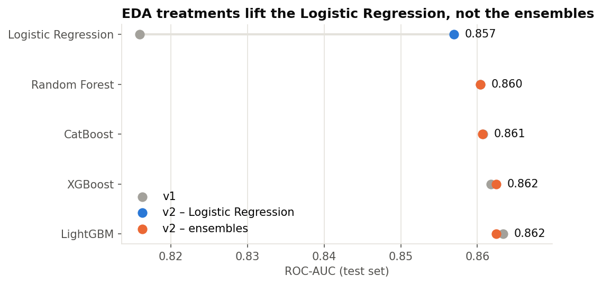
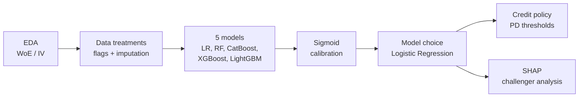
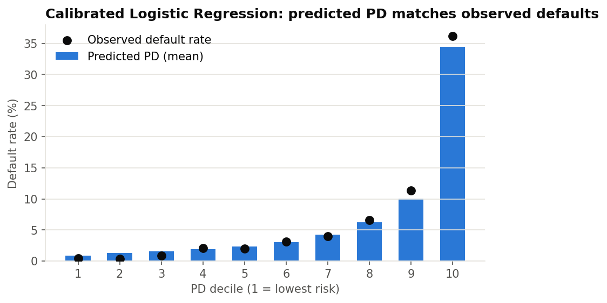
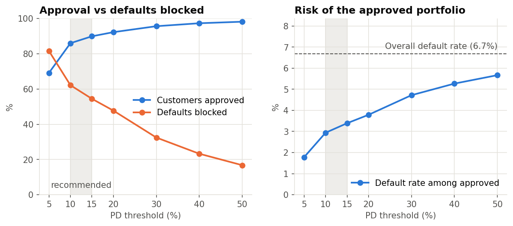
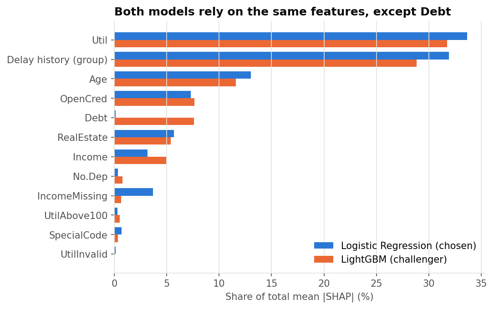

# Credit Risk Modeling: Probability of Default

End-to-end credit scoring project: from data cleaning to a calibrated, explainable **probability of default (PD)** model and a credit approval policy, with every modeling decision backed by data.

## At a glance

| | |
|---|---|
| **Chosen model** | Logistic Regression, calibrated (LightGBM kept as challenger) |
| **Ranking power (test set)** | ROC-AUC **0.857** · KS **0.559** · Gini **0.714** |
| **Calibration (test set)** | Brier score **0.050**, vs 0.062 for a constant prediction; mean predicted PD matches the observed default rate |
| **Business impact** | At a 10% PD threshold, **86% of applicants are approved** and the default rate of the approved portfolio falls from **6.7% to 2.9%**, blocking 62% of all defaults |
| **Key finding** | Fixing data issues found in the EDA raised the Logistic Regression AUC by **+0.04**, bringing it within ~0.01 of the best ensemble |



## Problem and data

A lender needs to estimate, for each applicant, the probability of a serious delinquency (90+ days past due) within two years, and turn that estimate into an approve / reject decision.

- **Dataset:** [Give Me Some Credit](https://www.kaggle.com/c/GiveMeSomeCredit) (Kaggle): 150,000 customers, 10 features (credit utilization, age, past delays, debt ratio, income, open credit lines, real estate loans, dependents).
- **Imbalanced target:** 6.68% of customers default (about 1 in 15).
- **Split:** stratified 70% train / 15% validation / 15% test. The test set is used only for the final numbers.

## Approach



1. **EDA** on the train set only, with Weight of Evidence and Information Value per feature ([notebook](notebooks/01_eda.ipynb), [WoE/IV notes](notes/woe_iv_explained.md)).
2. **Data treatments** in a scikit-learn pipeline, fitted on the train set only (no leakage), with named columns end to end ([`src/feature_creation.py`](src/feature_creation.py), [`src/processing.py`](src/processing.py)).
3. **Five models** with fixed hyperparameters and class balancing ([`src/modeling.py`](src/modeling.py)).
4. **Calibration** with a sigmoid fitted on the validation set and evaluated on the test set ([`src/calibration.py`](src/calibration.py)).
5. **Model choice, credit policy and explainability** in notebooks 02 to 04.

## Key decisions and what I learned

**1. The EDA found three data issues, and fixing them mainly helped the linear model.**

| Issue found in the EDA | Treatment |
|---|---|
| Codes 96/98 in the delay counts are not real counts (182 customers, 54% default) | Flag `SpecialCode` + replaced by the median |
| Credit utilization above 1,000% is a data error (0.16% of customers) | Flag `UtilInvalid` + replaced by the median |
| For customers with no usable income (missing, 0 or 1), `Debt` holds the debt **amount** instead of the debt-to-income **ratio** (21% of customers) | Flag `IncomeMissing` + `Debt` replaced by the median ratio |

The treatments raised the Logistic Regression test AUC from **0.816 to 0.857** and did not change the ensembles. Tree models already isolated these values with their splits; a linear model cannot, and the extreme values were distorting its standardization. The flags keep the information: each of these groups has its own default rate.

**2. I chose the Logistic Regression over LightGBM, even though LightGBM is slightly better.**
LightGBM wins on every metric, but by little: about 0.006 in test AUC and 0.001 in calibrated Brier score. In exchange, the Logistic Regression is explained directly by its coefficients: each feature has one effect, with a fixed sign, the same for every customer. That makes it easy to justify a decision to a customer or a credit committee.

**3. Calibration is not optional.**
Class balancing improves ranking but inflates the raw probabilities: the raw models predict a mean PD of about 32%, against a real default rate of 6.7%. After the sigmoid calibration, the mean PD is 6.6% and the predicted PD matches the observed default rate in every decile, with no change in ranking.



**4. A challenger model shows where the chosen model can improve.**
Comparing LightGBM (via SHAP) with the Logistic Regression showed that both rely on the same features, except `Debt`, which has a threshold effect that a straight line cannot capture. It also revealed a weakness of the linear model: **extrapolation on extreme values**. For example, the 19 validation customers with utilization between 200% and 1,000% have a 21% default rate, but the Logistic Regression gives them a mean PD of 83%. These findings define the next improvement (see *Next steps*).

## Results

All five models, on the **test set**:

| Model | ROC-AUC | KS | Gini | Brier (calibrated) |
|---|---|---|---|---|
| **Logistic Regression** (chosen) | 0.857 | 0.559 | 0.714 | 0.0500 |
| Random Forest | 0.860 | 0.572 | 0.721 | 0.0497 |
| CatBoost | 0.861 | 0.567 | 0.721 | 0.0496 |
| XGBoost | 0.862 | 0.569 | 0.725 | 0.0496 |
| LightGBM (challenger) | 0.862 | 0.572 | 0.725 | 0.0489 |

The four ensembles are practically tied. Full evaluation, including overfitting, v1 vs v2 and calibration: [`02_model_evaluation.ipynb`](notebooks/02_model_evaluation.ipynb).

## Business application: credit policy

A customer is approved when the calibrated PD is at or below a threshold. Results with the Logistic Regression on the test set:

| PD threshold | Approved | Default among approved | Defaults blocked | Good customers rejected |
|---|---|---|---|---|
| 5% | 69.2% | 1.8% | 81.6% | 27.2% |
| **10%** | **86.0%** | **2.9%** | **62.2%** | **10.5%** |
| **15%** | **89.9%** | **3.4%** | **54.4%** | **6.9%** |
| 20% | 92.3% | 3.8% | 47.7% | 4.9% |
| 30% | 95.7% | 4.7% | 32.5% | 2.3% |



The **10%–15% range** offers the best balance: the default rate of the approved portfolio is about half the overall rate, and only 7%–11% of good customers are turned away. Because the model is calibrated, the exact threshold can be set from unit economics: approving is profitable when PD < margin / (margin + loss given default). Details: [`04_credit_policy.ipynb`](notebooks/04_credit_policy.ipynb).

## Explainability

- **Logistic Regression coefficients** (standardized features): utilization (+0.72) and any past delay (+0.42) are the strongest risk drivers; age (−0.28) and income (−0.19) reduce risk.
- **SHAP** on the challenger LightGBM, plus exact SHAP values of the Logistic Regression for a side-by-side comparison: global importance, dependence plots, customers where the two models disagree, and local explanations. Details: [`03_shap_analysis.ipynb`](notebooks/03_shap_analysis.ipynb).



## Repository structure

```
├── data/
│   ├── raw/                 # original Kaggle file
│   └── processed/           # train / validation / test splits
├── notebooks/
│   ├── 01_eda.ipynb                 # exploratory analysis, WoE / IV
│   ├── 02_model_evaluation.ipynb    # metrics, v1 vs v2, calibration, model choice
│   ├── 03_shap_analysis.ipynb       # SHAP and challenger comparison
│   └── 04_credit_policy.ipynb       # PD thresholds and business trade-off
├── src/
│   ├── split_data.py        # stratified train / validation / test split
│   ├── feature_creation.py  # data cleaning (flags) and derived features
│   ├── processing.py        # preprocessing pipelines (fit on train only)
│   ├── modeling.py          # training of the 5 models
│   ├── evaluation.py        # ROC-AUC, KS, Gini, Brier
│   ├── calibration.py       # sigmoid calibration and decile analysis
│   ├── scenario_analysis.py # credit policy metrics
│   └── report_figures.py    # figures used in this README
├── models/                  # preprocessors and trained models
├── calibration/             # calibrated models and decile plots
├── reports/
│   ├── metrics/             # metrics of the current version (v1 in metrics/v1/)
│   ├── credit_policy/       # policy table
│   └── figures/             # README figures
└── notes/                   # WoE / IV explanation
```

The notebooks are meant to be read in order (01 to 04). All of them are saved with their outputs, so they can be read on GitHub without running anything.

## How to reproduce

Requires **Python 3.12+** (developed on 3.13).

```bash
git clone https://github.com/hnascimento96/Credit-Risk-Modeling.git
cd Credit-Risk-Modeling
python3 -m venv .venv
source .venv/bin/activate
pip install -r requirements.txt
pip install -e .
```

`requirements.txt` pins the exact library versions: the saved models depend on them. `pip install -e .` makes the `src` package importable from the notebooks.

The data splits and all trained artifacts are already in the repository, so the notebooks can be run right away. To rebuild everything from the processed data, run the scripts in this order:

```bash
python -m src.processing       # fit and save the preprocessors
python -m src.modeling         # train the 5 models
python -m src.evaluation       # train / validation metrics
python -m src.calibration      # calibrate and evaluate on the test set
python -m src.report_figures   # regenerate the README figures
```

### Troubleshooting

**macOS:** avoid cloning the project into folders synced with iCloud (such as `~/Documents` or `~/Desktop`). iCloud can mark files as hidden, and Python 3.13+ then ignores the `.pth` file that registers the package, causing `ModuleNotFoundError: No module named 'src'`. If it happens, run:

```bash
chflags nohidden .venv/lib/python3.*/site-packages/__editable__*.pth
```

and restart the notebook kernel.

## Limitations and next steps

**Limitations**
- The dataset has no dates, so no **out-of-time** validation was possible; a threshold should be confirmed on more recent customers before use.
- The data likely contains only previously approved customers (**reject inference**), which can bias the PD of applicants who would have been rejected.
- The policy analysis uses rates, not money; a profit-based analysis would need real margins, exposures and loss given default.
- Hyperparameters are fixed (no tuning), so that the v1 vs v2 comparison isolates the effect of the preprocessing.

**Next steps**
1. Limit extreme values of utilization and income in the Logistic Regression (caps or bins) to remove the extreme PDs.
2. Add bins or WoE features for the non-linear effects found with SHAP (delay score, age, debt ratio, real estate loans).
3. Train without class balancing and compare discrimination and calibration.

## Tech stack

Python · pandas · NumPy · scikit-learn · LightGBM · XGBoost · CatBoost · SHAP · Matplotlib · Jupyter

## Author

**Hamilton Nascimento** · [GitHub](https://github.com/hnascimento96)